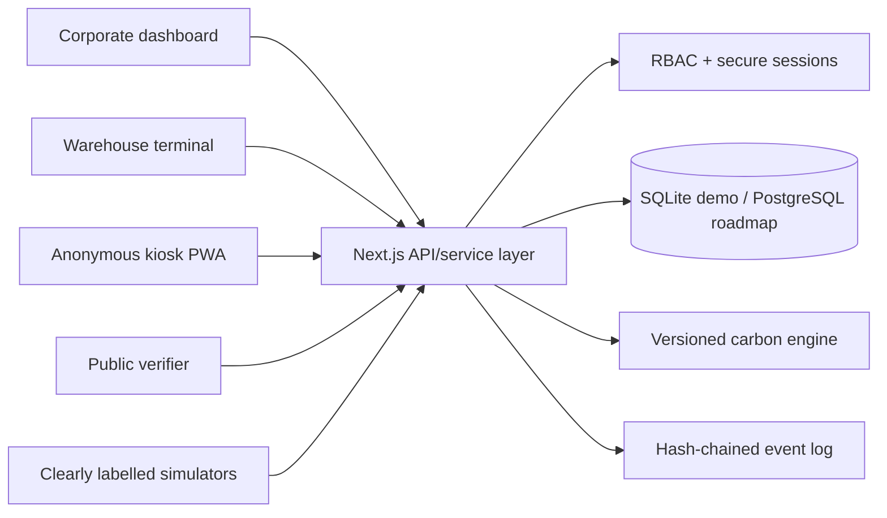
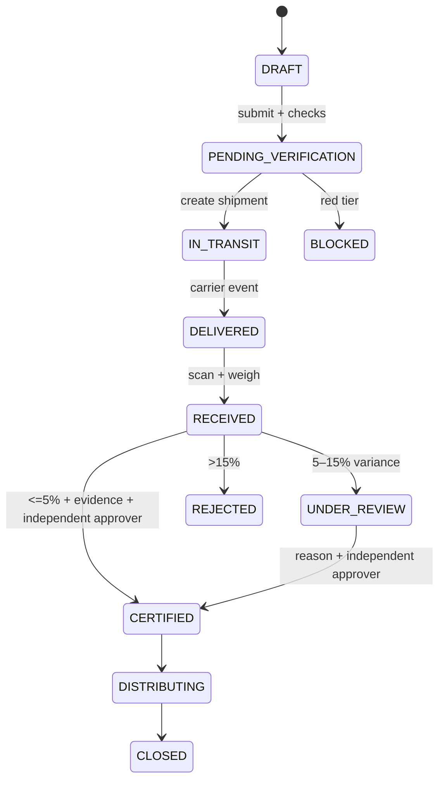
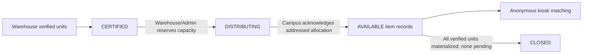

# EcoDrops MVP Design

## Architecture

EcoDrops is a Next.js App Router monolith written in strict TypeScript. Server-rendered pages provide fast first paint; JSON route handlers form a versioned `/api/v1` boundary; SQLite provides a reproducible local system of record. Business rules live in framework-independent modules so they can be property-tested and later moved to PostgreSQL without changing product behavior.



## Key decisions

- **Web rather than native desktop:** judges get a zero-install URL while the responsive PWA still works as a warehouse terminal and kiosk.
- **One TypeScript stack:** shared domain types reduce handoff and serialization mistakes during the hackathon.
- **SQLite for the submission:** no credentials or Docker are needed for local judging. The schema deliberately avoids SQLite-only business logic so hosted PostgreSQL is a direct production migration.
- **Server sessions rather than browser tokens:** random tokens are stored only in secure, HTTP-only cookies; the database stores only token hashes.
- **Sourced methodology, conservative assumptions:** EPA WARM v16 / USEEIO are linked as source families. Product-level proxy factors, displacement, retention, and handling remain visibly labelled assumptions until category-specific or supplier data is loaded.
- **No student account:** kiosk sessions expire and carry only need/compatibility answers.

## Modules

| Module | Responsibility |
| --- | --- |
| `lib/db.ts` | schema creation, prepared-query access, deterministic seed bootstrap |
| `lib/auth.ts` | password hashing, session rotation, role checks |
| `lib/domain.ts` | shared states and public view models |
| `lib/workflow.ts` | legal transitions, variance and certification invariants |
| `lib/carbon.ts` | low/base/high calculations and smoothed rates |
| `lib/audit.ts` | canonical JSON, event hash chaining, chain verification |
| `lib/service.ts` | transactional use cases and organization scoping |
| `app/api/v1/[...segments]` | schema validation, RBAC, idempotency, stable errors |
| `components/*` | role dashboards, batch timeline, simulator and kiosk journey |

## Principal workflow



## Security boundaries

- Passwords use Node `scrypt` with per-user random salts.
- Session tokens contain 256 bits of entropy; only SHA-256 digests are stored.
- Protected operations perform server-side role and organization checks.
- Same-origin enforcement protects cookie-authenticated mutations; cookies use `HttpOnly`, `SameSite=Lax`, and `Secure` in production.
- Uploads are capped, checked by MIME type and PDF magic bytes, renamed with random identifiers, and never served by user-provided names.
- Public certificate projections are explicit allowlists.
- The event chain and certification snapshot make later edits detectable; they are audit-ready, not a third-party audit.

## Calculation

For each scenario (`low`, `base`, `high`):

```text
embodied_new = unit_weight_kg × factor_kgCO2e_per_kg
avoided_item = max(0, embodied_new × displacement_rate × retention_rate − handling_kgCO2e)
batch_avoided = avoided_item × eligible_units
```

Each certificate snapshots all inputs, factor source and version, formula version, and units. Increasing retention cannot lower the estimate; applying retention cannot exceed the displacement-only estimate; verified units cannot exceed claimed units.

## Accessibility and privacy

The visual system uses semantic landmarks, visible focus, minimum 44px targets, non-color status labels, reduced-motion support, and responsive layouts. Kiosk controls remain operable by keyboard and offer high-contrast/large-type modes. Dashboards aggregate student outcomes; no student identity enters the schema.
## HS policy and campus distribution extension

Schema v2 adds an active, versioned exact-code HS policy plus `campus_allocations` and `allocation_items`. The server derives category and baseline risk from the catalog; the browser cannot select an emissions factor or bypass blocked policy with a different category. Unknown codes fail closed, while the UI discloses that HS identifies product class rather than condition, safety, authenticity, or recall status.



Allocation capacity is `verified units − existing physical item rows − pending allocation quantity`. Every item counts once regardless of AVAILABLE, CLAIMED, RETURNED, DISTRIBUTED, or DIVERTED state. Campus receipt and item creation are atomic and idempotent; kiosk visibility begins only after receipt.